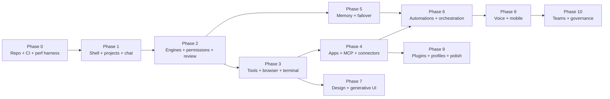

# 08 — Roadmap & Build Order

**Owner:** research session 1 · **Status:** proposed · **Depends on:** all of `01`–`07`

---

## 1. Why this order

The strongest temptation in a project like this is to start with the impressive surface: the chat, the beautiful panels, the agent doing twelve things at once. That is exactly backwards. The expensive-to-retrofit parts are **the permission gate, the event log, the snapshot/undo system and the provider abstraction**. If agents can write files before those exist, every later feature inherits an unsafe default. So phases 1–2 are deliberately unglamorous: a working shell, a chat that streams, and safety around file changes. Autonomy is added only on top of that.

Second principle: **each phase must end with something runnable and testable**. No phase ends in "architecture complete".

---

## 2. Dependency graph

---

## 3. Phases

### Phase 0 — Foundations (1–2 weeks)

**Goal:** a repo where agents can work safely and where performance is measurable.
- Monorepo scaffolding (pnpm + Cargo workspaces), LICENSE, CONTRIBUTING, codeowners, issue templates.
- CI: build matrix (win/mac/linux), `cargo test`, Vitest, formatting/lint, Playwright smoke.
- `perf.yml`: idle RAM/CPU, cold start, installer size budgets from `04-tech-stack.md`.
- ADRs 0001–0003 (Tauri, SQLite, MCP).
- **Exit:** CI green on all three OSes; perf harness reports numbers; ADRs merged.

### Phase 1 — Shell, projects and chat (2–4 weeks)

**Goal:** open the app, add a folder as a project, send a message, see streaming text.
- Tauri window, tray, renderer shell, design tokens, keyboard navigation.
- `cap-store` schema + migrations; `Project`, `Chat`, `Turn`, `Event`.
- Project sidebar with many projects, status chips, tool-state retention model.
- Embedded editor (read + simple edit), PTY terminal with `portable-pty`.
- Chat UI with action cards, stop button, per-chat mode picker (UI only for now).
- **Exit:** 3 projects open simultaneously; terminal state survives switching; perf budget holds.

### Phase 2 — Engines, permissions and review (3–5 weeks) ⚠️ *most important*

**Goal:** an agent can edit a file, and you can see, approve and undo it.
- `cap-engine` adapter trait; one adapter (OpenAI-compatible) with streaming `TurnEvent`s.
- Connection/settings UI for API keys; keychain broker; provider-neutral model list.
- Five model tiers; per-chat engine/model; context ring.
- `cap-sandbox`: filesystem fence, network policy, path validation.
- Permission gate, approval cards, per-tool Auto/Ask/Off, trusted sites, auto-approve categories.
- File snapshots, Review panel with diffs and comments, Revert and Rewind.
- Audit log + Settings → Privacy guarantees.
- **Exit:** an agent edits a file in Auto-edit, the diff appears in Review, and Rewind restores it. Nothing left the machine except provider calls.

### Phase 3 — Tool runtime, browser and dev server (2–4 weeks)
- Built-in tools: read/write/edit/glob/grep/bash/web/task.
- Plan mode with plan cards and revise/approve.
- Mid-turn steering + queue; `/compact`; subagent cards.
- Persistent browser tabs, sign-ins, dev-server preview and ready detection.
- Git panel (status/stage/diff/commit), `.env` redaction.
- **Exit:** "build a small page, start dev server, preview it, commit it" works end to end.

### Phase 4 — Apps, MCP and connectors (3–5 weeks)
- App runtime, dock, Spotlight, per-project app links.
- MCP client with capability tiers and per-tool permission UI.
- First connectors: **Gmail, GitHub, Slack, Google Calendar, Supabase, Vercel**, Database app.
- "Not connected" tool-server status handling.
- **Exit:** ask in chat → Gmail draft appears in the app tab → user approves sending.

### Phase 5 — Memory and provider failover (3–4 weeks)
- Memory writer: sessions → Markdown pages, links, knowledge map.
- FTS5 + sqlite-vec hybrid retrieval; per-project and Global scopes.
- Review queue, user-edit authority, per-change undo.
- Multiple accounts per provider, usage-limit failover, usage ring, caps.
- Local model discovery (Ollama / LM Studio / llama.cpp).
- **Exit:** a decision made in project A is recalled in project B; a simulated limit moves the turn to a second connection without losing history.

### Phase 6 — Automations and orchestration (4–6 weeks)
- Scheduler in tray; triggers (cron, webhook, app event, manual); step builder.
- Sandbox profiles; run history with cost and traces; notifications; missed-run policy.
- Director-style orchestrator: delegate chats, status map, question routing, watches.
- Inbox (approvals/questions/plans/results across all chats).
- **Exit:** a weekday standup automation runs with no window open, and a Director coordinates two delegate chats across projects.

### Phase 7 — Design app and generative UI (4–8 weeks)
- Canvas, prototypes, design systems from tokens/CSS/PDF.
- Handoff to code (frozen HTML, tokens, per-element IDs).
- Generative UI components (table, chart, board, form).
- Motion timeline + MP4 export, product demos, slide decks (lower priority within phase).
- **Exit:** describe a screen, get a clickable prototype, hand it to the build in the same project.

### Phase 8 — Voice and mobile (3–5 weeks)
- Local whisper.cpp STT, voice orb, hold/hands-free, keyword commands, dictionary.
- Optional spoken replies and mini orb.
- Encrypted mobile bridge, QR pairing, device revocation, Tailscale option.
- **Exit:** pair a phone, approve a pending decision from it, dictate a message with on-device STT.

### Phase 9 — Plugins, profiles and polish (3–4 weeks)
- Plugin manifest + SDK, community connector registry, settings/profiles.
- Advanced features: edit-sent-prompt, share-to-web, progress plans, Docker panel.
- Keyboard shortcut audit, accessibility pass, UI performance pass.
- **Exit:** a third-party plugin installs from a manifest and adds a panel + command.

### Phase 10 — Teams and governance (later)
- Organization model, permission matrix, model/MCP allowlists, spend caps, versioned policies, audit export, EU pinning, shared starters/skills.
- **Exit:** an admin publishes a policy and every seat picks it up on next launch.

---

## 4. Ordering rules for agents

1. Never start a phase whose dependencies are not `done` (see `00-START-HERE.md` status list).
2. Within a phase, do **security and storage before UI** when both are present.
3. A feature is not done until it has: tests, docs update, audit hooks, and a perf note.
4. If a phase is too large, split by *vertical slice* (one connector end to end), not by layer ("all UI, then all backend").
5. Prefer one excellent connector over ten stubs — the MCP boundary makes the rest cheap later.

---

## 5. What to build first if time is short

**A single vertical slice:** project folder → chat → OpenAI-compatible engine → one file edit → approval card → diff in Review → Rewind → commit. That slice proves the whole thesis. Everything else is a variation on it.
